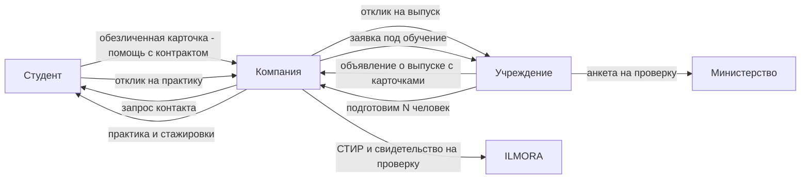

# ТЗ ILMORA — реестр учреждений, компании, студенты

> [!summary] Коротко
> ILMORA остаётся платформой учебных центров (курсы Duo/Trio, подписки, QR-посещаемость). **Рядом** добавляется реестр учебных учреждений Узбекистана для министерства и связка «учреждение ↔ компания ↔ студент». Всё, что описано ниже, делаем **одной фазой до среды, 11 ноября, 23:59**.
> Ключ, на котором держится вся связка, — **направление с обязательной отраслью**. По отрасли рассылаются уведомления, по ней же министерство получает цифры.

Основа — план Тимура на 9–11 ноября. Отличие от него: студенты, помощь с оплатой контракта, объявления о выпуске, практика и сертификаты **тоже входят к 11.11** (решение от 9.11).

**Содержание**
1. Что делаем и что не трогаем
2. Роли и кабинеты
3. Справочники: отрасли, направления, типы, регионы
4. Регистрация и анкеты
5. Связи между участниками
6. Уведомления
7. Кабинет министерства и цифры
8. Персональные данные и согласия
9. Задачи по ролям: дата-инженер, бэкенд, фронтенд, кибербез, QA
10. Порядок работ до среды
11. Не входит
12. Открытые вопросы
13. Решения, принятые в ТЗ по умолчанию

---

## 1. Что делаем и что не трогаем

**Не трогаем.** Подписки Duo/Trio, курсы, группы, расписание, оплата Payme/Click, QR-посещаемость, кабинеты Super Admin, Teacher Studio, учебного центра и студента работают как работали. Новое добавляется рядом: новые роли, кабинеты, разделы. Регресс старого — критическая ошибка.

**Добавляем:**
- реестр учреждений: техникумы (600+), вузы, школы, лицеи, учебные центры, государственные и частные;
- анкеты учреждений с проверкой министерством;
- компании с проверкой ILMORA;
- студентов и абитуриентов с анкетой «уже учусь / хочу поступить»;
- пять связей (раздел 5): объявления о выпуске, заявки «под обучение», помощь с оплатой контракта, практика и стажировки, сертификаты;
- уведомления в кабинете;
- кабинет министерства: проверка анкет и цифры;
- загрузку справочника учреждений из Excel.

**Учебные центры**, которые уже работают в ILMORA, участвуют в связке с компаниями так же, как техникумы: это учреждение типа «учебный центр».

---

## 2. Роли и кабинеты

| Роль | Кто | Как получает доступ | Что делает |
|---|---|---|---|
| Студент | учится или собирается поступать | регистрация (как сейчас) + анкета | анкета, сертификаты, помощь с контрактом, практика и стажировки |
| Учреждение | представитель техникума, вуза, школы, лицея, учебного центра | регистрация «Учреждение» → СТИР → одобрение министерства | паспорт учреждения, направления, студенты, объявления о выпуске, отклики на заявки компаний |
| Компания | представитель компании | регистрация «Компания» → СТИР + свидетельство → проверка ILMORA | отрасли, отклики на выпуск, заявки «под обучение», карточки студентов, практика и стажировки |
| Министерство | сотрудники министерства | аккаунт создаёт Super Admin, своей регистрации нет | проверка анкет учреждений, все цифры, выгрузка в Excel |
| Super Admin (ILMORA) | мы | как сейчас (owner) | проверка компаний, справочники, импорт реестра, слияние дублей, аккаунты министерства |
| Преподаватель, админ учебного центра | как сейчас | без изменений | без изменений |

На экране регистрации к нынешним вариантам добавляются **«Учреждение»** и **«Компания»**. «Министерство» на регистрации не показывается никогда.

Один аккаунт — одно учреждение или одна компания. Один представитель на учреждение или компанию (несколько сотрудников — не к среде).

---

## 3. Справочники

### 3.1 Отрасли (категории)

Короткий фиксированный список. Обязателен везде: в направлениях, у компаний, в заявках, в вакансиях. Правит только Super Admin. Названия на uz/ru/en.

Черновик списка (утвердить, см. раздел 12):

1. IT и связь
2. Строительство и архитектура
3. Мебель и деревообработка
4. Бизнес, экономика и финансы
5. Сельское хозяйство и пищевая промышленность
6. Медицина и фармацевтика
7. Образование и педагогика
8. Транспорт и логистика
9. Энергетика, нефть и газ
10. Машиностроение и металлообработка
11. Текстиль и лёгкая промышленность
12. Химия и горное дело
13. Туризм, гостиничное дело и общепит
14. Сервис и бытовые услуги
15. Дизайн, искусство и медиа
16. Право и госуправление
17. Другое (модератор потом переносит в нужную отрасль)

### 3.2 Направления (блоки)

Официального списка направлений пока нет, поэтому направление — **поле ввода с подсказками, которое пополняет общий справочник**:

1. Пользователь начинает печатать → после 2 символов видит подсказки из справочника (с отраслью рядом).
2. Нашёл → выбирает, направление встаёт **блоком (чипом)**, отрасль подставляется сама.
3. Не нашёл → «Добавить „<текст>“» → выбирает отрасль из списка 3.1 → направление **сразу сохраняется в справочник** блоком внутри этой отрасли (категории) и с этого момента появляется в подсказках у всех.
4. Добавленные пользователями направления помечены «добавлено пользователем». Super Admin может переименовать, сменить отрасль, **слить дубли** (все ссылки переносятся на основное направление).
5. Поиск дублей при вводе: без учёта регистра и лишних пробелов, кириллица и латиница считаются одинаково (узбекский пишут обеими: «Dasturlash» = «Дастурлаш»).
6. Если министерство даст классификатор специальностей с кодами — загружаем, такие направления помечены «официальное».

Это **один компонент** на всю систему: его используют учреждения, студенты, заявки компаний, вакансии.

### 3.3 Типы учреждений

В реестре: техникум, колледж (если будут в справочнике министерства), лицей, школа, вуз, учебный центр. Форма собственности: государственное / частное.

Что может выбрать студент:
- «Уже учусь»: **техникум, вуз, школа**
- «Хочу поступить»: **техникум, лицей, вуз**

### 3.4 Регионы и районы

14 регионов (12 областей, Республика Каракалпакстан, город Ташкент) и районы. Источник — коды СОАТО (если министерство даст в справочнике — берём оттуда).

### 3.5 Реестр учреждений

Один общий список. Откуда попадают записи:
- **импорт** из Excel министерства (основной источник);
- **само учреждение**, если не нашло себя при регистрации;
- **студент**, если не нашёл своё заведение (раздел 4.1). Такая запись сразу доступна другим студентам, помечена «добавлено студентом», в официальные цифры министерства не входит, пока не подтверждена. Super Admin сливает её с настоящей записью, когда та появится.

---

## 4. Регистрация и анкеты

### 4.1 Студент

**Шаг 0.** Регистрация как сейчас: логин, пароль, согласие с офертой.

**Шаг 1.** Выбор: **«Уже учусь»** или **«Хочу поступить»**.

**Шаг 2а. «Уже учусь»**

| Поле | Обязательно | Как |
|---|---|---|
| Тип заведения | да | техникум / вуз / школа |
| Заведение | да | поиск по реестру с фильтром по типу и региону. Нет в списке → ввести название + регион → сохраняется в реестр (3.5) |
| Курс | да | 1–6; для школы — класс 1–11 |
| Направление | да, кроме школы | поле 3.2. Для школы — «какое направление интересует», необязательно |
| Форма обучения | да, кроме школы | грант / контракт |
| Сумма контракта в год, сум | если контракт | число |
| Год окончания | да | год |

**Шаг 2б. «Хочу поступить»**

| Поле | Обязательно | Как |
|---|---|---|
| Тип заведения | да | техникум / лицей / вуз |
| Заведение | да | как выше; есть вариант «ещё не решил» |
| Год поступления | да | год |
| Направление | да | поле 3.2 |
| Планируемая форма | да | грант / контракт / пока не знаю |
| Сумма контракта, сум | нет | если известна |

**Шаг 3. Личные данные:** ФИО, дата рождения, регион и район, телефон, email, «о себе» (до 500 знаков). Если по дате рождения **меньше 18** — ФИО и телефон родителя или законного представителя и отметка «согласие родителя получено».

**Шаг 4. Согласия** (раздел 8) — отдельные галочки, по умолчанию выключены.

**Подтверждение учёбы.** Если студент выбрал «уже учусь» в учреждении, которое зарегистрировано и одобрено, он попадает в список «Студенты» этого учреждения. Учреждение подтверждает или отклоняет. На карточке студента виден значок «учёба подтверждена учреждением».

**Старые аккаунты студентов** (учебные центры) не блокируются: видят баннер «Заполните анкету», всё остальное работает как раньше.

**Новые разделы в кабинете студента:** Моя анкета · Сертификаты · Помощь с оплатой контракта · Практика и стажировки · Запросы от компаний · Уведомления.

### 4.2 Учреждение

**Как регистрируется:**
1. Регистрация «Учреждение»: логин, пароль, ФИО представителя, должность, телефон.
2. Вводит **СТИР** (9 цифр). Нашлось в реестре → карточка подставляется из справочника. Не нашлось → заполняет с нуля. На этой странице — **видеогайд** «как найти себя и заполнить анкету».
3. Если по этому СТИР уже есть представитель (анкета на проверке или одобрена) — новая заявка не создаётся: «Учреждение уже зарегистрировано, напишите в поддержку». Так никто не перехватит чужое учреждение.
4. Заполняет **паспорт учреждения** (таблица ниже) и направления.
5. Отправляет на проверку министерству. Статусы: черновик → на проверке → одобрено / отклонено (с причиной; можно исправить и отправить снова).
6. До одобрения в кабинете доступен только паспорт. Студенты, объявления, заявки компаний — после одобрения.

**Паспорт учреждения** (пока карточка с данными, сканы документов не нужны):

| Поле | Обязательно | Примечание |
|---|---|---|
| Тип | да | 3.3 |
| Форма собственности | да | государственное / частное |
| Название | да | как в документах |
| СТИР | да | 9 цифр, уникальный |
| Регион, район | да | 3.4 |
| Адрес | да | |
| Телефон | да | |
| Email, сайт | нет | |
| Директор, ФИО | да | |
| Представитель: ФИО, должность, телефон | да | из аккаунта |
| Направления | да, минимум одно | для каждого: направление (3.2), отрасль подставляется, отделение или факультет (необязательно), **сколько студентов** на направлении (да) |
| Всего студентов | считается | сумма по направлениям |
| Всего направлений | считается | |

Учебный центр, который уже работает в ILMORA, регистрируется так же. Связь записи реестра с существующим центром ставит Super Admin.

**Правка после одобрения:** название, СТИР, тип, форма собственности, регион → снова на проверку (кабинет при этом работает). Направления, количество студентов, контакты — правятся сразу, каждое изменение пишется в журнал.

**Разделы кабинета учреждения:** Паспорт · Направления · Студенты (подтверждение) · Объявления о выпуске · Отклики компаний · Заявки компаний «под обучение» · Уведомления. Наверху всегда виден статус проверки.

### 4.3 Компания

**Как регистрируется:** «Компания» → логин, пароль, ФИО контактного лица, должность, телефон, email → анкета → на проверку ILMORA.

| Поле | Обязательно | Примечание |
|---|---|---|
| СТИР | да | 9 цифр, уникальный. Уже есть компания с этим СТИР → «уже зарегистрирована, напишите в поддержку» |
| Название | да | |
| Отрасли | да, одна или несколько | список 3.1 |
| Направления работы | нет | блоки 3.2, уточняют отрасль |
| Регион, район, адрес | да | |
| Свидетельство о государственной регистрации | да | PDF / JPG / PNG до 10 МБ. Видят только модераторы ILMORA |
| Сайт, о компании | нет | |

**Проверка ILMORA:** модератор вручную сверяет СТИР и название со свидетельством (при необходимости — по открытым источникам налоговой) → одобрить / отклонить с причиной. До одобрения доступна только анкета.

Для компаний ILMORA **бесплатна**.

**Разделы кабинета компании:** Анкета · Выпускники (объявления о выпуске) · Заявки «под обучение» · Студенты (помощь с контрактом) · Практика и стажировки · Мои контакты · Уведомления.

### 4.4 Министерство

Аккаунты создаёт Super Admin в админке (с записью в журнал). Самостоятельной регистрации нет. Вход — логин, пароль и **SMS-код** (OTP уже есть в API). Областных и районных управлений пока нет.

---

## 5. Связи между участниками

Общие правила:
- Видят и получают уведомления только **одобренные** учреждения и компании.
- **Совпадение по отрасли:** компания получает объявление или заявку, если **хотя бы одна** её отрасль совпадает с отраслью направления.
- ILMORA **только сводит стороны**. После взаимного согласия стороны видят телефоны и email друг друга, дальше общаются сами. Чата в ILMORA нет.

### 5.1 Объявление о выпуске → отклик компании

**Учреждение создаёт объявление:**
1. Год выпуска.
2. Строки: направление (из своих направлений) → отрасль подставляется → сколько выпускников. Пример: IT — 200, мебель — 100, бизнес — 300. «Итого» считается само.
3. **Карточки студентов подтягиваются автоматически**: подтверждённые студенты этого учреждения с тем же направлением, годом окончания = году выпуска и **согласием на показ карточки** (раздел 8). Учреждение может убрать студента из объявления; добавить студента без согласия нельзя.
4. Студенты без согласия входят в цифру, но их карточки не показываются.
5. «Опубликовать» → уведомление компаниям совпадающих отраслей.

**Что видит компания:** только строки своих отраслей и карточки студентов из этих строк. Карточка выпускника: ФИО, учреждение, направление, год выпуска, регион, «о себе», названия сертификатов, курсы в ILMORA, значок «учёба подтверждена». **Телефон, email и файлы сертификатов скрыты** до тех пор, пока студент не примет запрос контакта.

**Компания:**
- **«Откликнуться»** на объявление: какие строки, сколько человек нужно, комментарий → уведомление учреждению → учреждение принимает / отклоняет. После принятия обе стороны видят контакты друг друга.
- **«Пригласить»** конкретного выпускника → запрос контакта студенту (тот же механизм, что в 5.3).

После публикации объявление можно править и закрыть. Если добавлена строка с новой отраслью — уведомление получают только компании этой новой отрасли. Одна компания получает одно уведомление на одно объявление.

### 5.2 Заявка компании «под обучение» → отклик учреждения

1. Компания создаёт заявку: направление (3.2) → отрасль подставляется; сколько человек; к какому году; регион (или «любой»); требования (текст).
2. Уведомление получают учреждения, у которых есть направление этой отрасли (и, если указан регион, — только в нём).
3. Учреждение откликается: **«Подготовим N человек к году Y»** + комментарий.
4. Компания видит отклики → принимает / отклоняет. После принятия обе стороны видят контакты.
5. Компания может закрыть заявку.

### 5.3 Помощь с оплатой контракта

**Студент** («уже учусь» или «хочу поступить») нажимает «Помощь с оплатой контракта»:
1. Проверяется, что анкета заполнена: заведение, направление, форма, сумма контракта.
2. Дополнительно: почему нужна помощь (до 1000 знаков), сколько лет готов отработать, где готов работать (свой регион / любой).
3. Галочка согласия на отправку **обезличенной** карточки компаниям. Для несовершеннолетних — обязательны данные родителя и отметка о его согласии.
4. Заявка уходит компаниям, у которых отрасль совпадает с отраслью направления студента (уведомление).

**Обезличенная карточка:**

| Показывается компаниям | Скрыто до согласия студента |
|---|---|
| номер карточки, возраст, регион | ФИО, дата рождения |
| учреждение, тип, направление, отрасль | телефон, email |
| курс или год поступления, форма, сумма контракта | файлы сертификатов |
| «почему нужна помощь», сколько лет готов отработать | данные родителя |
| названия сертификатов, курсы в ILMORA | |
| значок «учёба подтверждена» | |

**Дальше:**
1. Компания нажимает «Заинтересованы» → студенту приходит **запрос контакта** с названием и описанием компании.
2. Студент принимает или отклоняет.
3. Принял → компания видит полную карточку (ФИО, телефон, email, файлы сертификатов), студент видит контакты компании.
4. Договор «компания платит контракт — студент после учёбы отрабатывает» стороны заключают **сами, вне ILMORA**. Деньги идут напрямую компания → учреждение. На странице это написано прямым текстом.
5. Студент отмечает «Договор заключён» и выбирает компанию — это нужно для цифр министерства.

Статусы заявки студента: активна → есть интерес компаний → договор заключён / отозвана. У студента одна активная заявка. Отозвал — карточка сразу перестаёт показываться.

### 5.4 Практика и стажировки

**Компания создаёт вакансию:** тип (практика / стажировка), название, направление(я) → отрасль, регион и адрес, формат (на месте / удалённо / смешанно), оплачивается ли (и сумма — необязательно), длительность, сколько мест, требования, срок приёма откликов. Публикуется без отдельной проверки (компания уже проверена).

**Студент:** раздел «Практика и стажировки» — список, по умолчанию отфильтрован по отрасли студента и его региону, фильтры можно менять. «Откликнуться» → сопроводительный текст → компания получает отклик **с полной карточкой** (на кнопке написано: «Компания увидит ваши ФИО, контакты и сертификаты»).

Статусы отклика: новый → просмотрен → приглашён / отказ. Студенту приходит уведомление при каждой смене статуса.

### 5.5 Сертификаты

- Раздел «Сертификаты» в кабинете студента: загрузить файл (PDF / JPG / PNG, до 10 МБ, не больше 20 файлов), название, кто выдал, дата (необязательно). Переименовать, удалить. Подлинность не проверяется.
- Блок **«Курсы в ILMORA»** заполняется автоматически: курсы учебных центров, где у студента была подписка, с процентом посещаемости (из существующих данных). ILMORA сама сертификатов не выдаёт, поэтому здесь записи, а не файлы.
- Файлы видит только сам студент. Компания — после принятия запроса контакта или при отклике студента на вакансию.

---

## 6. Уведомления

**Сейчас — только в кабинете** (колокольчик, список, счётчик непрочитанных; модель Notification уже есть). **Почта — следующим шагом.** Отправку делать так, чтобы почта добавлялась как ещё один канал без переделки логики.

| Событие | Кому |
|---|---|
| Новая анкета учреждения на проверку | министерству |
| Анкета учреждения одобрена / отклонена | представителю учреждения |
| Новая компания на проверку | модераторам ILMORA |
| Компания одобрена / отклонена | компании |
| Студент подтверждён / отклонён учреждением | студенту |
| Опубликовано объявление о выпуске | компаниям совпадающих отраслей |
| Отклик компании на объявление | учреждению |
| Отклик на объявление принят / отклонён | компании |
| Новая заявка «под обучение» | учреждениям с направлениями этой отрасли (и региона) |
| Отклик учреждения на заявку | компании |
| Отклик на заявку принят / отклонён | учреждению |
| Новая заявка студента на помощь с контрактом | компаниям отрасли |
| Запрос контакта от компании | студенту |
| Студент принял / отклонил запрос | компании |
| Отклик на практику / стажировку | компании |
| Статус отклика на практику изменился | студенту |

Массовые рассылки — через фоновую очередь (BullMQ) пачками, не в запросе пользователя. Одно событие — одно уведомление получателю (dedupeKey).

---

## 7. Кабинет министерства и цифры

**1. Проверка анкет**
- Очередь анкет учреждений.
- В анкете видно: совпадает ли СТИР со справочником или его там нет, данные представителя.
- «Одобрить» / «Отклонить» (причина обязательна). История решений.

**2. Реестр**
- Все учреждения. Фильтры: тип, форма собственности, регион, район, отрасль, статус (из справочника, не заявилось / на проверке / одобрено / отклонено / добавлено студентами). Карточка — только просмотр.
- Вкладка «Компании»: название, СТИР, отрасли, регион (без свидетельства).

**3. Цифры** — фильтры по региону, типу, форме собственности, году:
- **Учреждения:** всего, по типам, формам собственности, регионам. Охват: сколько из справочника уже зарегистрировалось (шт. и %).
- **Студенты по данным учреждений:** по отраслям, направлениям, регионам.
- **Выпуск:** по годам и отраслям (из объявлений).
- **Спрос компаний:** компании по отраслям и регионам; заявки «под обучение» (сколько человек нужно); отклики учреждений (сколько готовы подготовить); отклики компаний на выпуск.
- **Спрос и предложение по отраслям** — выпуск против запрошенного компаниями. Главная таблица для министерства.
- **Студенты в ILMORA:** зарегистрировано, учатся / поступают, по типам заведений.
- **Абитуриенты:** сколько хотят поступить, по направлениям, типам заведений, годам.
- **Помощь с контрактом:** заявок, с интересом компаний, договоров заключено.
- **Практика и стажировки:** вакансий, мест, откликов, приглашений.
- **Выгрузка** любой таблицы в Excel.

В официальные цифры входят только **одобренные** учреждения. Записи, добавленные студентами, показываются отдельно. Персональных данных студентов министерство **не видит**, только цифры.

---

## 8. Персональные данные и согласия

> [!warning] Обязательно
> Карточки студентов уходят компаниям — это передача персональных данных третьим лицам. По закону РУз «О персональных данных» на это нужно согласие. Тексты согласий и вопрос с несовершеннолетними — **на проверку юристу** (см. `docs/compliance/` в репозитории).

**Отдельные согласия студента** (галочки по умолчанию выключены; хранится дата и версия текста):
1. Показывать мою карточку компаниям в объявлениях о выпуске моего учреждения.
2. Отправлять мою обезличенную карточку компаниям (помощь с контрактом).
3. Открыть мои контакты конкретной компании — каждый запрос отдельно, решает студент.

Отклик на вакансию — согласие действием (текст на кнопке, раздел 5.4).

**Несовершеннолетние (до 18 лет):** без данных родителя и отметки «согласие родителя получено» согласия 1 и 2 включить нельзя.

**Отзыв согласия:** карточка сразу пропадает из объявлений и ленты компаний. Контакты, которые компания уже получила, остаются у неё — студента предупреждаем об этом до отзыва.

**Журнал:** кто и когда открыл контакты студента, скачал файл, выгрузил Excel — пишется в AuditEvent.

Данные хранятся в Узбекистане (UzCloud), как сейчас.

---

## 9. Задачи по ролям

> [!important] Правило
> Схему базы и миграции меняет **только дата-инженер (чат БД)**. Нужно поле — через него.

### 9.1 Дата-инженер (БД)

**Модель.** Названия ориентировочные. Все таблицы с `tenantId`, через ту же Prisma-обёртку изоляции, что сейчас.

| Сущность | Ключевые поля |
|---|---|
| Industry — отрасль | name uz/ru/en, порядок, активна |
| Direction — направление | name, searchKey (нормализованный, см. ниже), industryId, official / добавлено пользователем, code (если классификатор), mergedIntoId, createdBy |
| Region, District | код СОАТО, name uz/ru |
| Institution — учреждение | type, ownership, name, stir (unique, nullable — у записей от студентов нет), regionId, districtId, address, phone, email, site, directorName, status, source (импорт / учреждение / студент), rejectReason, reviewedBy/At, centerId (связь с учебным центром ILMORA), createdBy |
| InstitutionDirection | institutionId, directionId, department (необяз.), studentsCount |
| Company — компания | stir (unique), name, regionId, districtId, address, site, about, certificateFileKey, status, rejectReason, reviewedBy/At |
| CompanyIndustry, CompanyDirection | связи компании с отраслями и (необяз.) направлениями |
| User | + institutionId / companyId, должность (по образцу centerId) |
| StudentProfile | userId, mode (учусь / поступаю), institutionType, institutionId (nullable — «ещё не решил»), course, enrollYear, graduationYear, directionId, studyForm, contractAmount, birthDate, regionId, districtId, about, parentName, parentPhone, studyConfirmation (статус), согласия (дата + версия каждого) |
| StudentCertificate | userId, title, issuer, issuedAt, fileKey |
| GraduationAnnouncement, …Line, …LineStudent | institutionId, year, status; строки: directionId, count; студенты строки |
| AnnouncementResponse | announcementId, companyId, строки, wantedCount, comment, status |
| TrainingRequest | companyId, directionId, count, byYear, regionId (необяз.), requirements, status |
| TrainingOffer | requestId, institutionId, count, byYear, comment, status |
| ContractHelpRequest | studentId, motivation, yearsToWork, workRegion, status, signedWithCompanyId |
| ContactRequest | companyId, studentId, source (выпуск / контракт), status, decidedAt |
| Vacancy | companyId, kind (практика / стажировка), title, directions, regionId, address, format, paid, stipend, duration, seats, requirements, deadline, status |
| VacancyApplication | vacancyId, studentId, note, status |
| Notification | уже есть, добавляются новые type |

**Роли:** в `Role` добавить `INSTITUTION_ADMIN`, `COMPANY_ADMIN`, `MINISTRY`.

**searchKey направления:** нижний регистр, обрезка и схлопывание пробелов, кириллица → латиница по узбекским правилам (ш→sh, ч→ch, ў→oʻ, ғ→gʻ, қ→q, ҳ→h, х→x, ж→j, й→y, ё→yo, ю→yu, я→ya, ц→ts).

**Импорт реестра из Excel:**
- команда на сервере + загрузка в админке;
- сопоставление колонок — когда придёт файл;
- проверки: СТИР 9 цифр, обязательные поля, тип, регион;
- повторный запуск ничего не дублирует (upsert по СТИР);
- пробный прогон с отчётом об ошибках;
- если в файле ФИО и телефоны — **файл не в GitHub**, только на сервер, после импорта удалить.

**Ещё:**
- справочники отраслей (черновик 3.1), регионов и районов;
- тестовые данные: 600+ учреждений и ~10 000 студентов для прогона;
- индексы под цифры министерства: регион, тип, форма собственности, отрасль, статус, год;
- запросы для дашборда; кэш в Redis на 5 минут, если не укладываемся в 2 секунды.

### 9.2 Бэкенд

**Модули NestJS:** registry (справочники, поиск), institutions, companies, students (анкета, сертификаты), matching (объявления, заявки, отклики, запросы контакта), vacancies, ministry (проверка, цифры, выгрузка). Регистрация: в `SELF_SERVICE_ROLES` (`account.service.ts`) добавить «Учреждение» и «Компания».

**Эндпоинты** (пути ориентировочные):

*Справочники*
- `GET /v1/registry/industries`, `/regions`, `/districts?regionId=`
- `GET /v1/registry/directions?q=&industryId=` — подсказки; `POST /v1/registry/directions` — добавить своё
- `GET /v1/registry/institutions?q=&type=&regionId=`; `POST /v1/registry/institutions` — студент добавляет заведение

*Учреждение*
- `POST /v1/institutions/claim` (СТИР); `GET/PUT /v1/institutions/me`; `POST /v1/institutions/me/submit`
- `GET/PUT /v1/institutions/me/directions`
- `GET /v1/institutions/me/students`; `POST …/students/:id/confirm|reject`
- объявления: CRUD `/v1/institutions/me/announcements`, `POST …/:id/publish|close`; отклики компаний: `GET …/responses`, `POST …/:id/accept|decline`
- `GET /v1/training-requests` (входящие); `POST /v1/training-requests/:id/offers`

*Компания*
- `GET/PUT /v1/companies/me`; `POST /v1/companies/me/submit`; ссылка на загрузку свидетельства
- `GET /v1/announcements` (только свои отрасли); `POST /v1/announcements/:id/responses`; `POST /v1/graduates/:studentId/invite`
- CRUD `/v1/companies/me/training-requests`; отклики учреждений: `GET`, `POST …/:id/accept|decline`
- `GET /v1/contract-help` (лента обезличенных карточек); `POST /v1/contract-help/:id/interest`
- CRUD `/v1/companies/me/vacancies`; отклики: `GET`, `POST …/:id/status`
- `GET /v1/companies/me/contacts`

*Студент*
- `GET/PUT /v1/students/me/profile`; `PUT /v1/students/me/consents`
- сертификаты: CRUD + ссылки на загрузку и скачивание
- `POST/GET/DELETE /v1/students/me/contract-help`
- `GET /v1/students/me/contact-requests`; `POST …/:id/accept|decline`
- `GET /v1/vacancies`; `POST /v1/vacancies/:id/apply`; `GET /v1/students/me/applications`

*Министерство*
- `GET /v1/ministry/reviews`; `POST …/:id/approve|reject`
- `GET /v1/ministry/institutions`, `/companies`; `GET /v1/ministry/stats/*`; `GET /v1/ministry/export?table=`

*Super Admin*
- импорт реестра (пробный и настоящий)
- проверка компаний: approve / reject
- направления: переименовать, сменить отрасль, слить
- учреждения от студентов: слить с записью реестра
- отрасли: правка
- аккаунты министерства: создать / отключить

**Правила:**
- Кто что видит — проверяется **на сервере** (матрица в 9.4). Обезличенная карточка физически не содержит скрытых полей в ответе API.
- Учреждение и компания до одобрения получают доступ только к своей анкете.
- Рассылка уведомлений — BullMQ, пачками, с dedupeKey.
- Файлы (свидетельства, сертификаты) — **приватные**: отдельный префикс, скачивание по временной ссылке на 5 минут. Сейчас загрузки отдают публичный URL — для документов так нельзя.
- Валидация (zod): СТИР — 9 цифр; годы в разумных пределах; количества > 0.
- Лимиты: добавление направлений и заведений студентом, запросы контакта от компании, отклики.
- Все решения проверок, слияния, импорт, раскрытие контактов, скачивания, выгрузки — в AuditEvent.

### 9.3 Фронтенд

**Регистрация:**
- выбор роли: Студент / Преподаватель / Учебный центр (как сейчас) + **Учреждение**, **Компания**;
- для студента — шаг «Уже учусь / Хочу поступить» и анкета пошагово (4.1).

**Кабинет студента** (`/student`), новые разделы:
- Моя анкета, Сертификаты, Помощь с оплатой контракта, Практика и стажировки, Запросы от компаний;
- баннер «Заполните анкету» для старых аккаунтов.

**Новые кабинеты:**
- **`/institution`** — Паспорт (с видеогайдом), Направления, Студенты, Объявления о выпуске, Отклики компаний, Заявки «под обучение», Уведомления. Статус проверки вверху.
- **`/company`** — Анкета (с загрузкой свидетельства), Выпускники, Заявки «под обучение», Студенты (помощь с контрактом), Практика и стажировки, Мои контакты, Уведомления.
- **`/ministry`** — Проверка, Реестр, Цифры (графики + таблицы + кнопка «Excel»).

**Админка** (`/admin`), новые разделы: Компании на проверке, Отрасли, Направления (слияние дублей), Импорт реестра, Заведения от студентов, Аккаунты министерства.

**Общие компоненты:**
- поле направления: подсказки, «Добавить», выбор отрасли, блок-чип;
- поиск учреждения: тип, регион, «нет в списке — добавить»;
- выбор региона и района;
- загрузка файла;
- карточка студента — обезличенная и полная.

**Требования:** языки uz / ru / en через общий словарь (как сейчас); мобильная вёрстка в первую очередь (студенты — с телефона); все кабинеты `noindex`; старые страницы не меняются.

### 9.4 Кибербез

**Матрица доступа:**

| Данные | Студент | Учреждение | Компания | Министерство | ILMORA |
|---|---|---|---|---|---|
| Анкета студента | правит свою | свои студенты: ФИО, курс, направление, год (без контактов) | — | только цифры | смотрит |
| Карточка выпускника (с согласием) | своя | своих студентов | смотрит строки своих отраслей, без контактов | только цифры | смотрит |
| Обезличенная карточка (контракт) | своя | — | смотрит своих отраслей | только цифры | смотрит |
| Контакты и файлы студента | свои | — | после принятия запроса или отклика на вакансию | — | смотрит, с записью в журнал |
| Паспорт учреждения | название, тип, регион (поиск) | правит свой | смотрит | смотрит, одобряет | смотрит, правит справочник |
| Анкета компании | название, отрасль (в вакансиях) | смотрит (в откликах) | правит свою | смотрит без свидетельства | смотрит, одобряет |
| Свидетельство компании | — | — | своё | — | смотрит |
| Объявления о выпуске | — | правит свои | смотрит своих отраслей | только цифры | смотрит |
| Заявки «под обучение» | — | смотрит своих отраслей | правит свои | только цифры | смотрит |
| Вакансии | смотрит | — | правит свои | только цифры | смотрит |

**Проверить и закрыть:**
- **Подмена id** в каждом эндпоинте: компания A не читает заявки и отклики компании B, учреждение — чужих студентов, студент — чужие запросы.
- **Обезличивание на сервере:** смотреть ответ API, а не экран.
- **Роли:** `MINISTRY` выдаёт только Super Admin; `INSTITUTION_ADMIN` / `COMPANY_ADMIN` — только через свою регистрацию; функции — только при статусе «одобрено».
- **Захват учреждения или компании:** один СТИР — один представитель.
- **Министерство и модераторы** входят с SMS-кодом.
- **Файлы:**
  - тип проверяется по содержимому, а не по расширению;
  - размер ограничен, имя файла не идёт в ключ;
  - доступ только по временным ссылкам, министерству файлы не отдаются.
- **XSS** в свободных полях: направления, «о себе», требования, комментарии. Направления показываются везде, так что это особенно важно.
- **Выгрузка Excel:** защита от формул в ячейках (значения, начинающиеся с `=`, `+`, `-`, `@`).
- **Лимиты запросов:** регистрация, добавление направлений и заведений, запросы контактов, отклики.
- **Excel министерства** с персональными данными — не в git, удалить с сервера после импорта.
- **Журнал** (раздел 8) пишется и читается только Super Admin.
- Перед релизом — проход по OWASP Top 10 по новым эндпоинтам.

### 9.5 QA

**Студент**
- [ ] Обе ветки регистрации («учусь» / «поступаю»), все типы заведений; у школы нет обязательного направления
- [ ] Новое заведение, введённое студентом, появляется в поиске у другого студента
- [ ] Новое направление сохраняется блоком в выбранной отрасли и появляется в подсказках у других
- [ ] «Dasturlash» и «Дастурлаш», «IT» и « it » — подсказывается существующее, дубль не создаётся
- [ ] Несовершеннолетний не может включить согласия без данных родителя
- [ ] Старый аккаунт студента: баннер есть, подписки и курсы работают

**Учреждение**
- [ ] СТИР из справочника → карточка подставляется; несуществующий СТИР → пустая анкета; занятый СТИР → отказ
- [ ] До одобрения закрыто всё, кроме паспорта; министерство одобряет / отклоняет с причиной; повторная отправка
- [ ] Правка названия или СТИР после одобрения → снова на проверку
- [ ] Подтверждение и отклонение студентов

**Компания**
- [ ] Загрузка свидетельства (неверный тип и размер отклоняются), проверка ILMORA, отказ с причиной

**Связи**
- [ ] Объявление с IT и бизнесом: IT-компания получает уведомление и видит только строку IT; компания «мебель» ничего не получает; компания с IT и бизнесом видит обе строки
- [ ] Неодобренная компания ничего не получает и не видит
- [ ] Студент без согласия — в цифре объявления, но без карточки
- [ ] Помощь с контрактом: в ответе API нет ФИО, телефона, email, файлов до принятия запроса; после принятия — есть; отзыв заявки убирает карточку
- [ ] Заявка «под обучение» → отклики учреждений → принятие → контакты
- [ ] Вакансия → отклик → статусы → уведомления студенту
- [ ] Одно событие — одно уведомление получателю

**Доступ и безопасность**
- [ ] Подмена id во всех запросах → 403 / 404
- [ ] Ссылка на файл перестаёт работать через 5 минут

**Министерство**
- [ ] Цифры совпадают с проверочным набором данных
- [ ] Учреждения, добавленные студентами, не попадают в официальные цифры
- [ ] Выгрузка Excel открывается, формулы не исполняются

**Не сломали старое**
- [ ] Подписка Duo/Trio, тестовая оплата, QR-отметка, кабинеты преподавателя и центра

**Нагрузка и вид**
- [ ] 600+ учреждений и 10 000 студентов: дашборд меньше 2 секунд
- [ ] uz / ru / en, мобильная ширина

---

## 10. Порядок работ до среды

Фаза одна. Ниже порядок, потому что одно зависит от другого.

| Когда | Кто | Что |
|---|---|---|
| Пн, 9.11 | Дата-инженер | модель, миграция, тестовые данные, справочник отраслей. До вечера согласовать поля с бэкендом |
| Пн | Бэкенд, фронтенд | каркас модулей и кабинетов; общие компоненты (поле направлений, поиск учреждения) на заглушках |
| Пн | Кибербез | матрица доступа (9.4), правила для файлов |
| Пн | QA | тест-кейсы по 9.5 |
| Вт, 10.11 | Бэкенд | все эндпоинты, рассылка уведомлений |
| Вт | Фронтенд | все анкеты и кабинеты |
| Вт | Дата-инженер | импорт справочника, регионы и районы |
| Вт | QA, кибербез | проверка того, что готово |
| Вт, ночь | — | смена машин в UzCloud (по плану Тимура, сайт ляжет на несколько минут) |
| Ср, 11.11 | Дата-инженер | цифры министерства, индексы, прогон на 600+ |
| Ср | QA, кибербез | полный прогон, проверка доступа |
| Ср, до вечера | все | релиз, проверка на сайте, запас до 23:59 |

---

## 11. Не входит

- Вход через OneID, подпись E-IMZO, связь с HEMIS.
- Деньги через ILMORA, составление и подпись договора. ILMORA только сводит стороны, деньги идут компания → учреждение напрямую. Отказ студента отрабатывать — по договору и через суд, не наша часть.
- Письма на почту (сейчас уведомления только в кабинете; почта — следующим шагом).
- Доступ областных и районных управлений.
- Сканы документов учреждения (пока только карточка с данными).
- Плата для компаний.
- Чат внутри ILMORA.
- Несколько представителей одного учреждения или компании.
- Проверка подлинности сертификатов.

---

## 12. Открытые вопросы

- [ ] Есть ли у министерства официальный классификатор специальностей с кодами?
- [ ] Что в справочнике по каждому учреждению: СТИР, район или код СОАТО, тип, форма собственности, есть ли ФИО и телефоны? Есть ли колледжи?
- [ ] Какое министерство, сколько нужно аккаунтов, кто их получает?
- [ ] Где живёт новый раздел (домен) и как называется?
- [ ] Тексты согласий и несовершеннолетние — юрист.
- [ ] Утвердить список отраслей (черновик в 3.1).
- [ ] Ресурсы UzCloud, экспертиза системы, государственный дата-центр — спросить министерство заранее (по плану Тимура).

---

## 13. Решения, принятые в ТЗ по умолчанию

Если что-то не так — поправить здесь, остальное подстроится.

1. Без согласия студента его карточка не показывается компаниям — ни в объявлениях, ни в помощи с контрактом. В цифрах он учитывается.
2. В карточке выпускника ФИО видно, а телефон, email и файлы — только после того, как студент примет запрос компании.
3. Заведение или направление, которое ввёл пользователь, сразу доступно всем с пометкой «добавлено пользователем». Дубли сливает ILMORA. Заведения от студентов не входят в официальные цифры, пока не подтверждены.
4. Учреждение подтверждает своих студентов (значок «учёба подтверждена»).
5. Компания видит в объявлении только строки своих отраслей.
6. Число студентов учреждения = сумма по направлениям, вводит само учреждение.
7. Один СТИР — один представитель. Повторно заявить уже заявленное учреждение или компанию можно только через поддержку.
8. У студента одна активная заявка на помощь с контрактом.
9. «Курсы в ILMORA» вместо автоматических сертификатов: ILMORA сама сертификатов не выдаёт.
10. Министерство и модераторы входят с SMS-кодом. Аккаунты министерства создаёт Super Admin.
11. О новых вакансиях студентам уведомления не приходят: список с фильтром по отрасли и региону.
12. Старые аккаунты студентов видят баннер «Заполните анкету», но не блокируются.
